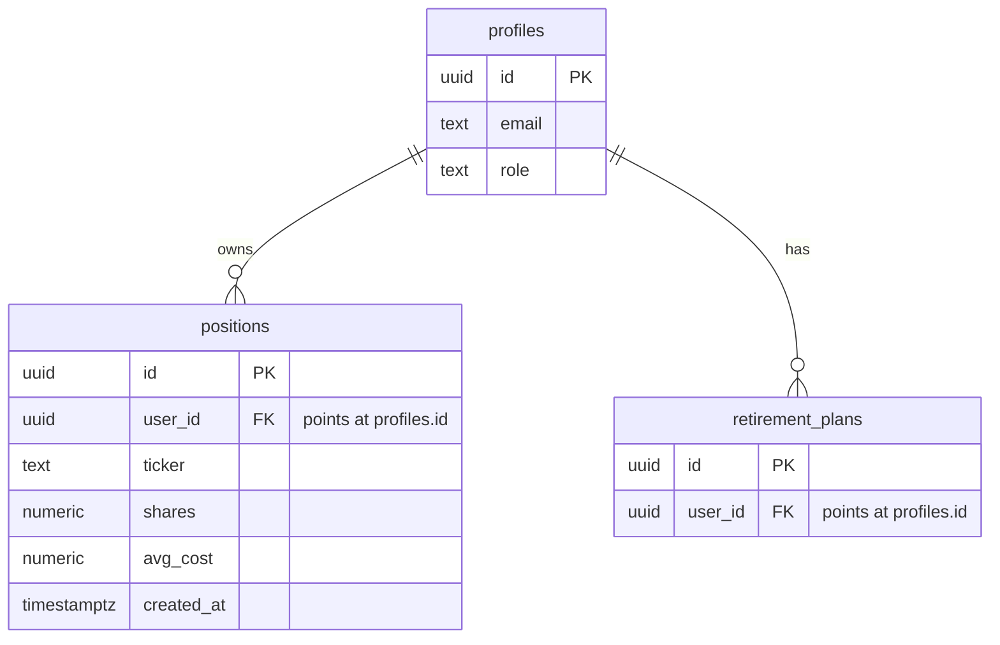

# Technology Literacy Curriculum (TLC)

## Module 5: Databases 101 — From Spreadsheets to SQL

**Status:** Draft v1 — built from live hands-on sessions, 2025–2026
**Track:** 2 — Backend & Databases
**Format:** Conceptual walkthrough with hands-on SQL lab using retire-time schema
**Prerequisite:** Module 4 — Frontend Fundamentals (understanding what data the frontend needs)
**Leads into:** Module 6 — Supabase Deep Dive (applying SQL concepts in a real cloud database)

**Sequencing note:** This module comes before Supabase specifically so that learners encounter the relational model on its own terms first. When they reach Supabase's dashboard and see tables, columns, and SQL queries, those concepts won't be foreign — they'll be recognizable as the same thing they already practiced here, just hosted in the cloud with extra features layered on top.

## Why This Module Exists

Most introductions to databases either skip the fundamentals entirely ("just use the ORM") or bury them in theory ("a relation is a set of tuples..."). Neither prepares someone for the moment they open a database dashboard and need to understand what they're looking at.

This module teaches databases by starting with something everyone already knows: a spreadsheet. The gap between a spreadsheet and a database is smaller than it looks — and the places where the gap opens up are exactly the concepts that matter. This module builds from that gap outward, using the actual schema from retire-time (a real personal finance app) as the working example throughout.

By the end, learners won't just know what SQL is — they'll understand *why* a database enforces rules a spreadsheet doesn't, what that buys you in a real application, and what it costs when you model data wrong from the start.

## Learning Objectives

By the end of this module, a learner should be able to:

1. Explain why a database exists and what problem it solves that a spreadsheet or CSV file cannot
2. Identify the components of a database table: columns (schema), rows (data), and primary keys
3. Explain what a **foreign key** is and why it represents a relationship between two tables
4. Write basic SQL queries: SELECT with WHERE filters, INSERT, UPDATE, DELETE
5. Explain what a **JOIN** does and when you need one (vs. when you don't)
6. Distinguish between **relational (SQL) databases** and **document (NoSQL) databases** and name one trade-off of each
7. Explain what a database **index** is and why it matters for query performance
8. Read a schema diagram and identify the tables, columns, data types, and relationships in a real application

## Core Concepts

### The Problem a Database Solves

A spreadsheet is a grid. It stores data, it can do math, and you can share it. For a single person tracking their own finances, it works fine. But spreadsheets start breaking down in four specific situations that databases are designed to handle:

**Multiple users writing simultaneously.** Two people editing the same spreadsheet at the same time produces conflicts. A database handles concurrent writes with transactions — changes either complete fully or don't happen at all.

**Referential integrity.** If you delete a stock from a "stocks" tab, every row in a "positions" tab that referenced that stock is now pointing at nothing. A database with a foreign key constraint prevents the deletion and tells you why.

**Querying at scale.** Filtering 50 rows in a spreadsheet is instant. Filtering 50 million rows is not. Databases are built to query large datasets efficiently, especially with indexes.

**Enforced schema.** A spreadsheet column can hold text in row 1 and a date in row 2 with no complaint. A database column has a declared type (INTEGER, TEXT, TIMESTAMPTZ) and rejects data that doesn't match.

### Tables, Rows, and Columns — the Building Blocks

A database table is like a spreadsheet tab with enforced structure. Every column has a name and a declared data type. Every row is one record.

The `positions` table from retire-time looks like this:

| Column | Type | Description |
|---|---|---|
| id | UUID | Unique identifier for each position |
| user_id | UUID | Which user owns this position |
| ticker | TEXT | Stock symbol (e.g., "AAPL") |
| shares | NUMERIC | Number of shares held |
| avg_cost | NUMERIC | Average purchase price per share |
| created_at | TIMESTAMPTZ | When the position was created |

Each row is one stock position owned by one user. The table enforces that every row has all required columns, that `shares` is always a number, and that `user_id` always refers to a real user.

### Primary Keys — the Row's Unique Identity

Every table should have a **primary key**: a column (or combination of columns) whose value is unique for every row. In retire-time, every table uses a UUID as its primary key — a randomly generated 128-bit identifier like `a4b8c2d1-...` that is guaranteed to be unique across all rows, all time, and all databases in the world.

Primary keys are how you refer to a specific row: "the position with id = a4b8c2d1" is unambiguous in a way that "the row with ticker = AAPL" is not (a user might own AAPL in multiple lots).

### Foreign Keys — relationships between tables

A **foreign key** is a column in one table that holds the primary key of a row in another table. It's how you express a relationship: "this position belongs to this user."

```sql
-- The positions table has a foreign key to the profiles table
user_id UUID REFERENCES profiles(id) ON DELETE CASCADE
```

This tells the database: `user_id` in `positions` must always match an existing `id` in `profiles`. If you try to insert a position for a user that doesn't exist, the database rejects it. If you delete a user, the database automatically deletes their positions (`ON DELETE CASCADE`).

This is what spreadsheets can't do: a cell that references another sheet has no enforcement. A foreign key is a contract the database upholds automatically.

Here's how the retire-time tables connect. Each line is a foreign key: many positions (and plans) belong to one user's profile.



*How to read it: `PK` is the primary key, `FK` is a foreign key. The `||--o{` line means "one profile, zero or more positions." Only the key columns of `retirement_plans` are shown.*

### The Four SQL Operations

SQL has four fundamental operations, often called CRUD (Create, Read, Update, Delete):

**SELECT — read data**
```sql
-- Get all positions for a specific user
SELECT ticker, shares, avg_cost
FROM positions
WHERE user_id = 'a4b8c2d1-...'
ORDER BY ticker;
```

**INSERT — add a new row**
```sql
-- Add a new stock position
INSERT INTO positions (user_id, ticker, shares, avg_cost)
VALUES ('a4b8c2d1-...', 'AAPL', 10, 175.50);
```

**UPDATE — change existing rows**
```sql
-- Update the share count after buying more
UPDATE positions
SET shares = 15, avg_cost = 180.00
WHERE id = 'position-uuid-here';
```

**DELETE — remove rows**
```sql
-- Remove a position that was sold
DELETE FROM positions
WHERE id = 'position-uuid-here';
```

### JOINs — combining data from two tables

A JOIN lets you combine columns from two tables into a single query result, using a foreign key as the connection.

```sql
-- Get each user's email alongside their positions
SELECT profiles.email, positions.ticker, positions.shares
FROM positions
JOIN profiles ON positions.user_id = profiles.id
WHERE positions.shares > 0
ORDER BY profiles.email, positions.ticker;
```

This query reaches into two tables at once: `positions` for the investment data and `profiles` for the user's email. The ON clause is the join condition — it says which columns connect the two tables.

**When you need a JOIN:** whenever the data you need to display spans two tables. When you don't need a JOIN: when all the data you need lives in one table.

### Relational vs. Document (NoSQL) — the fundamental trade-off

Relational (SQL) databases like PostgreSQL enforce a fixed schema and support JOINs across tables. Document databases like Firestore store JSON documents with no required structure.

**Relational wins when:** your data has real relationships (positions belong to users, users have plans), you need to query across those relationships, or you need aggregate functions like `SUM()`, `AVG()`, `GROUP BY`.

**Document databases win when:** your data is naturally hierarchical and self-contained (a chat message with its replies embedded), you need to scale writes across the globe with no coordination, or your schema is genuinely unknown at the start.

The trap: document databases feel easier at the start (no schema to design) and harder later (can't query across collections, no JOINs). Relational databases require upfront thinking and pay off as the application grows. For a financial app like retire-time — where you need to aggregate positions by user, calculate totals, and generate admin analytics — SQL is the right choice.

### Indexes — making queries fast

A database table without an index is searched row by row: "is this the row I want? no. next row..." An index pre-computes the answer to common lookups, the same way a book's index tells you which pages mention a topic without reading every page.

```sql
-- Without this index, every positions query scans the whole table
-- With it, finding all positions for a user is instant
CREATE INDEX positions_user_id_idx ON positions(user_id);
```

The rule of thumb: index the columns you filter on most often (foreign keys like `user_id`, and frequently searched columns). Don't index everything — indexes take space and slow down writes.

## Lab 1: Model a Portfolio Tracker as Tables

**Goal:** Translate a mental model (or a spreadsheet) of a personal finance app into proper relational tables.

**Steps:**

1. Start with the user's natural description: "I want to track which stocks I own, how many shares, what I paid, and my retirement savings plans." Write that down without thinking about tables yet.
2. Identify the **entities** — the things that need their own table. Usually these are nouns: users, positions, plans.
3. For each entity, identify its **attributes** — the columns it needs. For a position: ticker, shares, avg_cost, purchase date.
4. Identify the **relationships**: a position belongs to a user. A plan belongs to a user. Draw a simple diagram: boxes for tables, arrows for foreign keys.
5. Assign **data types** to each column: ticker is TEXT, shares is NUMERIC, created_at is TIMESTAMPTZ, user_id is UUID.
6. Decide on **primary keys**: UUID for all tables in this case.
7. Write the CREATE TABLE SQL for `profiles` and `positions`. Include the foreign key constraint.

**Discussion Prompts:**
- What happens in a spreadsheet if you rename a user's email? Does every row that referenced that email update automatically?
- Why is UUID a better primary key than an auto-incrementing integer (1, 2, 3...) for a web application?
- If a user deletes their account, what should happen to their positions? What SQL constraint expresses that?

## Lab 2: Write SQL Queries Against retire-time Data

**Goal:** Build fluency with SELECT, WHERE, ORDER BY, and aggregate functions using realistic data.

**Prerequisites:** Access to a Supabase project with the retire-time schema (or the SQL editor in any PostgreSQL tool).

**Steps:**

1. **Basic SELECT:** Retrieve all columns from the `positions` table. Observe the data types and what NULL looks like.
2. **Filter with WHERE:** Get only the positions where `shares > 0`.
3. **Sort with ORDER BY:** Sort positions by `avg_cost` descending (most expensive first).
4. **COUNT:** Count how many positions each user has: `SELECT user_id, COUNT(*) FROM positions GROUP BY user_id`.
5. **SUM:** Calculate the total invested per user: `SELECT user_id, SUM(shares * avg_cost) FROM positions GROUP BY user_id`.
6. **Combine:** Get the top 5 users by total portfolio value, sorted descending.

**Discussion Prompts:**
- What's the difference between WHERE and HAVING? (WHERE filters rows before grouping; HAVING filters after.)
- Why does `COUNT(*)` count all rows but `COUNT(column_name)` skips NULLs?
- When would you use `LIMIT` and when is it dangerous to use it?

## Lab 3: Understand a JOIN

**Goal:** Retrieve data that spans two tables and understand why a JOIN is necessary.

**Steps:**

1. Run this query and observe that the results show email addresses alongside positions — data from two different tables:
   ```sql
   SELECT profiles.email, positions.ticker, positions.shares, positions.avg_cost
   FROM positions
   JOIN profiles ON positions.user_id = profiles.id
   ORDER BY profiles.email;
   ```
2. Try removing the JOIN and replacing with just `FROM positions` — notice that `profiles.email` is no longer available.
3. Add a WHERE clause to narrow results to a single email: `WHERE profiles.email = 'you@example.com'`.
4. Add a calculated column: `positions.shares * positions.avg_cost AS total_invested`.

**Discussion Prompts:**
- Why do we need a JOIN at all? Why not just store the user's email in the positions table?
- What would go wrong if the same user changed their email and it was stored in every positions row?
- This is called a LEFT JOIN vs. INNER JOIN — look up the difference. Which one would you use to find users who have no positions at all?

## Assessment / Checklist (Learner Self-Check)

- I can explain what problem a database solves that a spreadsheet cannot
- I can identify the primary key in a table and explain why it must be unique
- I can explain what a foreign key is and what constraint it enforces
- I can write a SELECT query with a WHERE filter and an ORDER BY clause
- I can write INSERT, UPDATE, and DELETE statements
- I can explain what a JOIN does and write a simple one
- I can explain the relational vs. document trade-off and name a situation where each is preferable
- I can explain what a database index does and why you don't index every column

## Notes for Curriculum Build-Out (Next Steps)

- Consider adding a visual schema diagram for the retire-time database (profiles, positions, retirement_plans, price_alerts, push_subscriptions) — a picture of the foreign key relationships is worth more than a page of text
- Consider a short section on NULL handling, which trips up most beginners (NULL ≠ empty string ≠ zero; NULL comparisons require IS NULL not = NULL)
- The relational vs. NoSQL section here is intentionally brief — it's expanded into a full deep-dive in the Firestore vs. Supabase comparison module
- Consider pairing Lab 2 with the Supabase SQL editor specifically, so learners run queries against a real live database rather than a local tool — the feedback loop is faster and the data is real
- Source sessions: retire-time Supabase schema design, admin_get_analytics() SQL function (uses GROUP BY, COUNT, SUM across multiple tables), admin_get_users() (joins profiles with aggregated position/plan counts)
